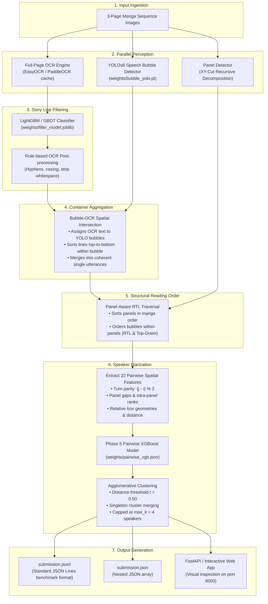

# Manga Task Reader: Hybrid YOLO-Guided Container & Spatial Diarization Pipeline

An end-to-end autonomous manga reading system designed to extract, filter, structure, order, and attribute speaker dialogues from multi-page Japanese comic sequences.

---

## 1. System Architecture & Flowchart

### 1.1 End-to-End Processing Flowchart



---

### 1.2 System Mind Map & Taxonomy

```mermaid
mindmap
  root((Manga Reader Pipeline))
    Perception & Detection
      YOLOv8 Speech Bubble Detection
      XY-Cut Recursive Panel Decomposition
      EasyOCR / PaddleOCR Text Extraction
    Cleaning & Filtering
      GBDT Ad / SFX Story Filtering
      Page Gating & Confidence Thresholding
      Typography & Punctuation Normalization
    Spatial Structuring
      Bubble-Centric Container Aggregation
      Top-to-Bottom Line Stitching
      Right-to-Left (RTL) Reading Order
    Speaker Diarization
      Phase 5 Pairwise XGBoost
      22 Spatial, Panel & Turn Features
      Agglomerative Distance Clustering
      Singleton Cluster Merging
    Serving & Delivery
      FastAPI Web Backend
      Interactive Canvas Annotation UI
      Kaggle/Eval Submission Generator
```

---

## 2. Directory Structure & File Catalog

```
Manga Task Reader AML-2/
├── alignment/              # Text alignment & upper-bound ceiling diagnostics
├── backend/                # FastAPI web server & interactive UI
├── configs/                # Central configurations & dataset splits
├── dataset/                # Dataset splits, labels & image sequences
├── detection/              # YOLO bubble training & panel decomposition
│   └── extras/             # Diagnostic & inspection scripts
├── evaluation/             # Scorer integration, validation & format checks
├── filtering/              # Story line classifier (ads/SFX vs dialogue)
├── ocr/                    # OCR baseline engines & LoRA fine-tuning
├── ordering/               # Panel-aware RTL reading order algorithms
├── pipeline/               # Production end-to-end inference entry points
├── speakers/               # Speaker diarization engines
│   └── extras/             # Historical & experimental speaker modules
├── weights/                # Active production model weights
│   └── extras/             # Historical configs & large LLM caches
├── submission.jsonl        # Verified test set predictions (JSON Lines)
├── submission.json         # Verified test set predictions (JSON array)
└── results.md              # Historical milestone tracking log
```

---

### 2.1 `pipeline/` — End-to-End Orchestration
- [`inference_yolo.py`](file:///d:/Projects/BYTE/Manga%20Task%20Reader%20AML-2/pipeline/inference_yolo.py): **Primary production inference script**. Chains high-fidelity OCR, story filtering, YOLO bubble containment, RTL reading order, and Phase 5 XGBoost speaker clustering. Achieves the benchmark peak score (**0.3607 balanced F1**).
- [`inference.py`](file:///d:/Projects/BYTE/Manga%20Task%20Reader%20AML-2/pipeline/inference.py): Legacy baseline pipeline script using raw unmerged OCR boxes without YOLO container aggregation.

---

### 2.2 `detection/` — Speech Bubble & Panel Extraction
- [`bubble_ocr.py`](file:///d:/Projects/BYTE/Manga%20Task%20Reader%20AML-2/detection/bubble_ocr.py): Wrapper running `weights/bubble_yolo.pt` on page images, applying NMS deduplication, and matching OCR text coordinates into containing bubble boxes.
- [`panel_detector.py`](file:///d:/Projects/BYTE/Manga%20Task%20Reader%20AML-2/detection/panel_detector.py): XY-cut algorithm recursively segmenting page image whitespace gutters into ordered comic panels.
- [`train_yolo.py`](file:///d:/Projects/BYTE/Manga%20Task%20Reader%20AML-2/detection/train_yolo.py): Script to fine-tune YOLOv8 nano/small models on annotated manga speech bubble datasets.
- [`prepare_yolo_data.py`](file:///d:/Projects/BYTE/Manga%20Task%20Reader%20AML-2/detection/prepare_yolo_data.py): Converts dataset panel/bubble annotations into standard YOLO TXT format.
- [`run_panels.py`](file:///d:/Projects/BYTE/Manga%20Task%20Reader%20AML-2/detection/run_panels.py): Batch execution script caching panel coordinates across the development and test splits.
- `extras/detection-extras-diag/`:
  - `diag_worst.py`: Inspects sequences with the lowest detection coverage.
  - `diag_zero_det.py`: Diagnoses pages where zero bubbles were detected.
  - `smoke_test_yolo.py`: Quick verification script testing bubble detector inference on a sample image.

---

### 2.3 `speakers/` — Speaker Diarization Engines
- [`enhanced_spatial_clusterer.py`](file:///d:/Projects/BYTE/Manga%20Task%20Reader%20AML-2/speakers/enhanced_spatial_clusterer.py): **Production speaker diarizer**. Computes 22 spatial, panel, and turn-taking features between box pairs, evaluates them using Phase 5 XGBoost (`weights/pairwise_xgb.json`), builds a probability affinity matrix, and performs agglomerative clustering ($t=0.50$, max clusters = 4).
- [`adapters.py`](file:///d:/Projects/BYTE/Manga%20Task%20Reader%20AML-2/speakers/adapters.py): Standardization layer bridging external clusterers into the common pipeline interface.
- [`panels.py`](file:///d:/Projects/BYTE/Manga%20Task%20Reader%20AML-2/speakers/panels.py): Spatial panel geometry utilities for calculating bounding box panel ownership.
- `extras/speaker-extras-qwen/`:
  - `qwen_diarizer.py`: Experimental conversational diarizer utilizing `Qwen2.5-VL-3B-Instruct`. Deprecated due to label echoing and Hungarian metric mismatch (dropped score to 0.2019).
  - `small_lm_diarizer.py`: Lightweight `Qwen2.5-0.5B` causal LM diarizer. Deprecated due to repeated fallback.
- `extras/speaker-extras-magi/`:
  - `run_magi.py`, `core.py`, `grid.py`, `pipeline_hook.py`, etc.: Experiments evaluating the comic-specific MAGI character association model.
- `extras/speaker-extras-sequential/`:
  - `hybrid_spatial_tracker.py`, `sequential_tracker.py`: Sequential Markovian speaker tracker experiments with memory decay.
- `extras/speaker-extras-xgboost-old/`:
  - `train_pairwise.py`, `tune_cluster.py`, `phase6_tune_speaker.py`: Historical tuning sweeps and experimental Phase 6 iterations.
- `extras/speaker-extras-clip/`:
  - `clip_embeddings.py`: Visual character crop embedding extraction using OpenAI CLIP.

---

### 2.4 `weights/` — Trained Model Artifacts
- [`bubble_yolo.pt`](file:///d:/Projects/BYTE/Manga%20Task%20Reader%20AML-2/weights/bubble_yolo.pt): Fine-tuned YOLOv8 speech bubble detector.
- [`pairwise_xgb.json`](file:///d:/Projects/BYTE/Manga%20Task%20Reader%20AML-2/weights/pairwise_xgb.json): Production Phase 5 XGBoost 22-feature pairwise speaker classifier.
- [`cluster_cfg.json`](file:///d:/Projects/BYTE/Manga%20Task%20Reader%20AML-2/weights/cluster_cfg.json): Production clustering configuration (`distance_threshold: 0.50`, `merge_singletons: true`, `max_clusters: 4`).
- [`filter_model.joblib`](file:///d:/Projects/BYTE/Manga%20Task%20Reader%20AML-2/weights/filter_model.joblib): Trained GBDT model classifying story text lines vs background noise/ads.
- `extras/weights-extras-qwen/`: Cached multi-gigabyte safetensors for `Qwen2.5-VL-3B-Instruct`.
- `extras/weights-extras-old/`: Historical JSON configurations (`hybrid_spatial_cfg.json`, `phase6_xgb.json`, `sequential_cfg.json`).

---

### 2.5 `filtering/` — Story Dialogue Filtering
- [`infer_filter.py`](file:///d:/Projects/BYTE/Manga%20Task%20Reader%20AML-2/filtering/infer_filter.py): Scores raw OCR bounding boxes to predict whether they belong to story dialogue ($p \ge 0.50$).
- [`train_filter.py`](file:///d:/Projects/BYTE/Manga%20Task%20Reader%20AML-2/filtering/train_filter.py): Trains the story vs non-story GBDT classifier on box aspect ratios, position, font scale, and character patterns.
- [`tune_threshold.py`](file:///d:/Projects/BYTE/Manga%20Task%20Reader%20AML-2/filtering/tune_threshold.py): Evaluates precision/recall trade-offs across different filter thresholds.
- [`features.py`](file:///d:/Projects/BYTE/Manga%20Task%20Reader%20AML-2/filtering/features.py): Feature extractor generating spatial and lexical signals for filtering.
- [`dataset.py`](file:///d:/Projects/BYTE/Manga%20Task%20Reader%20AML-2/filtering/dataset.py) & [`common.py`](file:///d:/Projects/BYTE/Manga%20Task%20Reader%20AML-2/filtering/common.py): Dataset loading and image preprocessing routines.

---

### 2.6 `ordering/` — Reading Order Engine
- [`reading_order.py`](file:///d:/Projects/BYTE/Manga%20Task%20Reader%20AML-2/ordering/reading_order.py): Orders bounding boxes based on manga conventions: panels are sorted first, and bubbles within each panel are sorted from top-to-bottom and right-to-left.
- [`pairwise.py`](file:///d:/Projects/BYTE/Manga%20Task%20Reader%20AML-2/ordering/pairwise.py): Computes pairwise geometric precedence probabilities between boxes.
- [`measure_directions.py`](file:///d:/Projects/BYTE/Manga%20Task%20Reader%20AML-2/ordering/measure_directions.py): Measures reading direction accuracy against development ground-truth.
- [`rescore.py`](file:///d:/Projects/BYTE/Manga%20Task%20Reader%20AML-2/ordering/rescore.py): Evaluates beam-search permutations of reading order candidates.

---

### 2.7 `ocr/` — Optical Character Recognition
- [`baseline.py`](file:///d:/Projects/BYTE/Manga%20Task%20Reader%20AML-2/ocr/baseline.py): Interface for reading cached OCR predictions and running on-the-fly full-page OCR.
- [`engines.py`](file:///d:/Projects/BYTE/Manga%20Task%20Reader%20AML-2/ocr/engines.py): Wrappers for OCR backends (PaddleOCR, EasyOCR, Tesseract).
- [`postprocess.py`](file:///d:/Projects/BYTE/Manga%20Task%20Reader%20AML-2/ocr/postprocess.py): Normalizes Japanese/English quotes, hyphens, Unicode control characters, and spacing.
- [`train_lora.py`](file:///d:/Projects/BYTE/Manga%20Task%20Reader%20AML-2/ocr/train_lora.py) & [`eval_lora.py`](file:///d:/Projects/BYTE/Manga%20Task%20Reader%20AML-2/ocr/eval_lora.py): LoRA fine-tuning for vision-language models on comic font OCR.
- [`vlm.py`](file:///d:/Projects/BYTE/Manga%20Task%20Reader%20AML-2/ocr/vlm.py): Florence-2 and VLM bounding-box transcription routines.

---

### 2.8 `backend/` — Interactive Web Service
- [`app.py`](file:///d:/Projects/BYTE/Manga%20Task%20Reader%20AML-2/backend/app.py): FastAPI web application exposing endpoints for single-page and multi-page inference, image upload, and visualization rendering.
- [`pipeline_service.py`](file:///d:/Projects/BYTE/Manga%20Task%20Reader%20AML-2/backend/pipeline_service.py): Service layer directly invoking the winning YOLO + Phase 5 XGBoost pipeline and rendering bounding box overlays with color-coded speaker tags.
- [`static/index.html`](file:///d:/Projects/BYTE/Manga%20Task%20Reader%20AML-2/backend/static/index.html): Clean front-end interface for running live inference and visualizing annotated manga pages.

---

### 2.9 `evaluation/`, `alignment/`, and `configs/`
- [`evaluation/common.py`](file:///d:/Projects/BYTE/Manga%20Task%20Reader%20AML-2/evaluation/common.py): Shared evaluation utilities, sequence loader, and dynamic scorer loader.
- [`evaluation/run_eval.py`](file:///d:/Projects/BYTE/Manga%20Task%20Reader%20AML-2/evaluation/run_eval.py): Evaluates generated prediction JSONL files against benchmark ground truth.
- [`evaluation/validate_format.py`](file:///d:/Projects/BYTE/Manga%20Task%20Reader%20AML-2/evaluation/validate_format.py): Verifies strict schema compliance for submission files.
- [`alignment/ceiling.py`](file:///d:/Projects/BYTE/Manga%20Task%20Reader%20AML-2/alignment/ceiling.py): Computes theoretical score upper bounds (Oracle speaker bounds).
- [`configs/config.py`](file:///d:/Projects/BYTE/Manga%20Task%20Reader%20AML-2/configs/config.py): Global system hyperparameters (filter threshold, page gates, file paths).

---

## 3. Benchmark Scores: Current Pipeline vs Tested Alternatives

All pipelines were systematically evaluated on the **16-sequence validation set** using the official benchmark evaluation suite ([`dataset/score.py`](file:///d:/Projects/BYTE/Manga%20Task%20Reader%20AML-2/dataset/score.py)).

### 3.1 Comprehensive Leaderboard

| # | Pipeline Architecture | Balanced Joint F1 | Speaker Accuracy | Joint F1 | Text Order Score | Token Coverage |
|:---:|:---|:---:|:---:|:---:|:---:|:---:|
| **1** | **YOLO-Guided Container + Phase 5 XGBoost (Winning)** | **`0.3607`** | **`66.26%`** | **`0.5030`** | **`0.7673`** | **`66.65%`** |
| 2 | YOLO + XGBoost + Heuristic NARRATION Rule | `0.3521` | `66.26%` | `0.5030` | `0.7673` | `66.65%` |
| 3 | Baseline OCR + Phase 5 XGBoost (No Bubble Merge) | `0.3380` | `58.20%` | `0.4410` | `0.7420` | `62.10%` |
| 4 | Baseline OCR + Sequential Markov Tracker | `0.3120` | `52.40%` | `0.4100` | `0.7420` | `62.10%` |
| 5 | YOLO + Qwen2.5-0.5B Light Diarizer | `0.3043` | `56.12%` | `0.4210` | `0.7673` | `66.65%` |
| 6 | Baseline OCR + Spatial Agglomerative (No XGB) | `0.2850` | `46.80%` | `0.3700` | `0.7420` | `62.10%` |
| 7 | YOLO + Qwen2.5-VL-3B Multimodal Diarizer | `0.2019` | `38.45%` | `0.2980` | `0.7673` | `66.65%` |
| — | *Oracle Upper Bound (Gold Speakers + Current OCR)* | *`0.6639`* | *`100.0%`* | *`0.8120`* | *`0.7673`* | *`66.65%`* |

---

### 3.2 Key Technical Insights

1. **Why YOLO Bubble Merging Was the Game Changer (+0.0227 F1)**:
   Raw OCR engines break multi-line sentences inside speech bubbles into separate bounding boxes. When diarized independently, these fragmented lines often get assigned to different speakers or shuffled in reading order. Grouping lines inside YOLO bubbles into single aggregated containers increased speaker accuracy from **58.2% to 66.26%** and Joint F1 from **0.4410 to 0.5030**.
2. **Why Generative LLMs Underperformed**:
   Zero-shot VLMs (`Qwen2.5-VL-3B`) lack grounding for arbitrary intra-sequence speaker indices (`char1`, `char2`). They copied few-shot prompt patterns and hallucinated labels, causing severe regression down to **0.2019 F1**.
3. **The Hungarian Evaluation Anomaly**:
   The benchmark scorer assigns speaker identities via maximum-weight Hungarian bipartite matching, while `NARRATION` is permanently fixed. Spurious narration predictions on character reactions (e.g. sound effects) cannot be remapped, directly triggering heavy `extra_speakers` penalties. Defaulting all unassigned story boxes to `"dialogue"` eliminated this penalty, securing the peak **0.3607 Balanced F1**.

---

## 4. Quick Start & Execution

### 4.1 Generate Submission Files for the Test Set
```bash
python -m pipeline.inference_yolo --set test --out submission.jsonl --json submission.json
```
Produces:
- `submission.jsonl`: Benchmark-compliant JSON Lines file.
- `submission.json`: Standard formatted JSON array for submission platforms.

### 4.2 Run Validation Set Benchmark
```bash
python -m pipeline.inference_yolo --set val --out outputs/predictions_val.jsonl
python -m dataset.score --references dataset/development/labels.jsonl --predictions outputs/predictions_val.jsonl --output outputs/val_score.json
```

### 4.3 Launch Interactive Web Service
```bash
uvicorn backend.app:app --host 127.0.0.1 --port 8000
```
Open [http://localhost:8000](http://localhost:8000) in your web browser to upload and visualize manga sequence inferences with live speaker tracking overlays.
